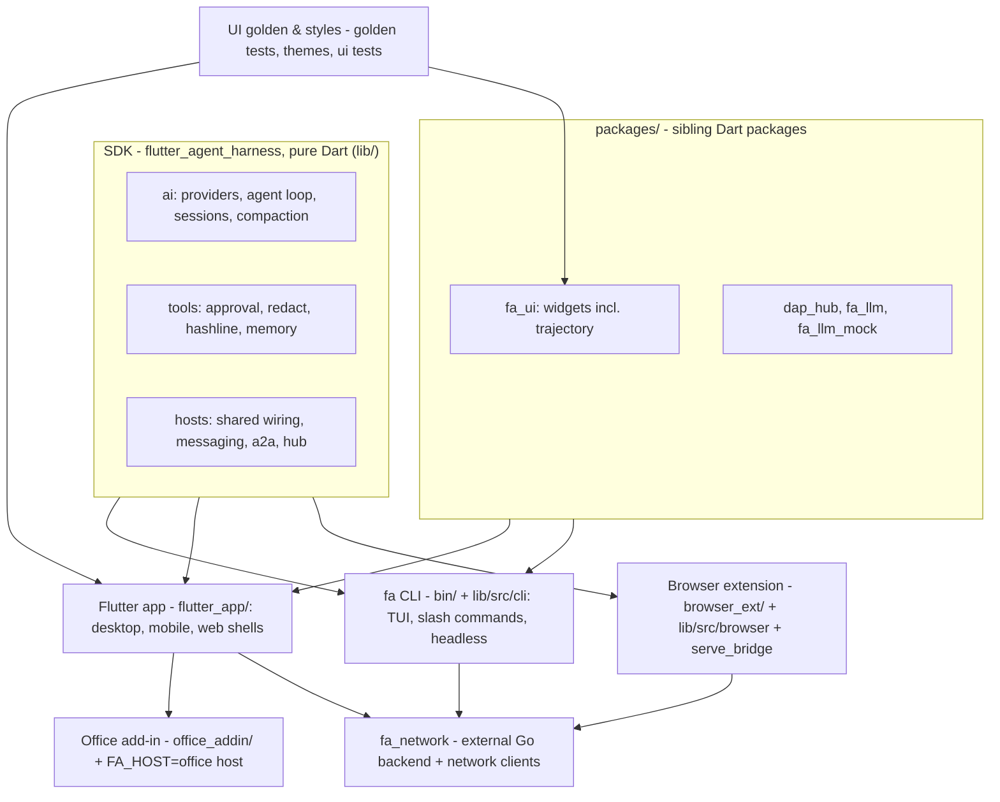

# AGENTS.md

Conventions for AI agents and contributors in this repository. This file is
the agent ENTRY document: the harness merges it into the system prompt with
a ~19 KB entry budget, so it must stay small enough to be fully visible.
Ceiling: **≤ 300 lines / ≤ 20 KB** — enforced by
`scripts/check_agents_md_size.sh` (pre-commit hook via `ci_fast_gate.sh` +
the CI `static` job). Subsystem essays live in `docs/` — index:
`docs/README.md`. Keep entries factual: paths, commands, invariants.

## Module map

## Project layout — one line per subsystem

Full subsystem reference: `docs/agents/sdk-subsystems.md` (SDK) +
`docs/agents/flutter-app-subsystems.md` (app/packages/repo-level).

**SDK core (`lib/`, pure Dart):**

- `lib/src/approval/` — tool approval gate: tiers, session modes, per-tool overrides, critical-bash interceptor, per-turn grants.
- `lib/src/tools/` — `ask`/`request_secret`/media tools, `read` selectors + archives + sqlite, background shell jobs, availability + load modes.
- `lib/src/env/` — `ExecutionEnv` impls: `LocalShell` (setsid, killTree, drain caps, self-signal immunity), session-correlation vars, in-memory default.
- `lib/src/agent/` — FinalizeGate, tool pairing, session image registry.
- `lib/src/trajectory/` — trajectory ledger core; goldens under `test/trajectory/golden/`.
- `lib/src/redact/` — layered secret redaction (prompt, tool args, output, logs).
- `lib/src/hashline/` — `[path#TAG]` patch language (SWAP/DEL/INS, stale-tag rejection).
- `lib/src/compaction/` — branch summarization + AutoCompactor → policy: `docs/compaction.md`.
- `lib/src/lsp/`, `lib/src/mcp/` — `lsp` + MCP protocol tooling (lazy servers, pure-Dart transports).
- `lib/src/model_roles/` — roles/fallbacks/keyring/watchdogs + provider catalog; `lib/src/ttsr/` — streaming-interrupt rules.
- `lib/src/skills/`, `lib/src/prompts/` — skills discovery; AGENTS/CLAUDE/GOAL/DESIGN auto-merge into the system prompt.
- `lib/src/task/`, `lib/src/messaging/`, `lib/src/session/attach/` — subagents, inbox fabric, attached sessions → `docs/subagents/README.md`.
- `lib/src/memory/` — long-term memory (hosted `flutter_agent_memory` package) → pitfalls: `docs/memory-churn.md`.
- `lib/src/a2a/` — Agent2Agent client/server/manager (`fa serve --a2a`).
- `bin/fah.dart` + `lib/src/cli/` — the `fa` CLI: REPL, slash commands, headless/serve modes → `docs/agents/cli.md`.
- `lib/src/cube/` — fa_cube sandbox profiles → `docs/cubes.md`; `lib/src/cli/hep.dart` — HEP event protocol → `docs/hep.md`.
- `lib/src/web_search/` — `web_search` (DDG keyless → keyed providers); `tools/fa-clip/` — native macOS pasteboard helper.

**packages/ + app shells:**

- `packages/fa_ui/` — reusable widgets (incl. trajectory) → `docs/agents/fa-ui.md`; `dap_hub`, `fa_llm`, `fa_llm_mock` → `docs/dap.md`.
- `flutter_app/` — the Flutter app (desktop/mobile/web) → `docs/agents/flutter-app.md`; services one-liner: `docs/agents/services.md`; JS apps: `docs/agents/js-apps.md`; HomeKit/Calendar/CodeMie: `docs/agents/system-integrations.md`.
- `browser_ext/` + `lib/src/browser/` + `bin/serve_bridge.dart` — browser extension + WebSocket bridge → `docs/browser-extension.md`.
- `office_addin/` + FA_HOST=office app host — Office add-in → `docs/outlook-addin.md`.
- `fa_network` — external Go backend bridged via the DAP hub (channel-id caveats: `docs/dap.md` §14).
- `site/`, `scripts/`, `docs/subagents/` — landing page (privacy sync), gates + codegen, subagents master plan → `docs/agents/flutter-app-subsystems.md`.

## Hard architecture rules (stay inline)

- `lib/` is pure Dart: **no `dart:io`** (must compile for web). The only
  `dart:io` entry points are `bin/` and `lib/io.dart`; file/process/network
  behind tools goes through the `ExecutionEnv` abstraction.
- Barrel `lib/flutter_agent_harness.dart`: grouped **APPEND-ONLY** export
  sections — one `// ── <subsystem> ──` header per group, sorted by path
  within a group, new exports append to their group. No mini-barrels, no
  re-sorting (gh-1232).
- God-file ceiling: no `.dart` file over **2800** lines (crap4dart `loc`
  gate). Target < 2000 for primary files; split by concern into `part`
  files — never by extracting public API.

## Working in parallel (shared checkout + worktrees)

Do not modify files in this shared checkout unless the user asked; run no
heavy commands (full suites/analyze) in it; never `git stash` the user's
WIP; talk to peer agents through the messaging fabric, not their files.
Worktrees only if genuinely required — ask first, create detached under
`.worktrees/<name>/` from the remote tracking ref, remove when done.
Full policy: `docs/agents/parallel-worktrees.md`.

## Memory (footnote)

Before any non-trivial task, **search memory first** (`memory_search`,
then `memory_list` for fuzzy topics). Scopes: **project** = this repo
(committed, `memory/note/` — the user's files: read freely, write only via
`memory_add`), **user** = global/private. `memory_add` stores durable facts
only; supersede by delete + add — never leave solved problems to rot. The
host recomposes the `<memory>` prompt section after every add; tool wiring
is `memoryTools` + `lib/src/memory/`. Churn pitfalls: `docs/memory-churn.md`;
usage details: `docs/agents/memory-usage.md`.

## Golden tests are MANDATORY for UI work

Any change to `flutter_app/lib/` UI code is INCOMPLETE until its golden
tests are done: coverage first (`test/golden/` + `golden_guard_test.dart`
map), real fonts (`ensureGoldenFonts`), full frames (1280x800 / 390x844),
determinism, eyes on pixels after `--update-goldens`, green
`flutter test test/golden` + `scripts/check_goldens.py` (orphan snapshots
hard-fail). Full rules: `docs/agents/golden-tests.md`.

## Prompts live outside Dart code

Every LLM prompt is a Markdown file under `prompts/**` (YAML frontmatter,
`{{token}}` placeholders) — never string literals in `.dart`. After
editing: `dart run scripts/gen_prompts.dart` regenerates the `.g.dart`
files (`test/prompts/prompts_sync_test.dart` gates drift); Codex catalog
refresh: `dart run scripts/sync_codex_models.dart`. Details:
`docs/agents/prompts.md`.

## Quality gates (pre-commit hook: `scripts/pre-commit`)

The hook is a thin wrapper over `scripts/ci_fast_gate.sh`; CI classifies
PRs through the same script (`--dry-run`) — one classifier, one threshold
set, hook/CI parity via `GATE_STAGE` markers. Path rules: docs/markdown/
prompts-only → size + analyze; lib/bin/test/pubspec → +tests, coverage,
CRAP, dup, dupx; `test/integration/**` → +integration-mock;
flutter_app/packages → +flutter; scripts/.github → everything. Invariants:

- analyze + format clean; `dart test` green — **deterministic-only**
  (mock LLM; live models never in the gate; `llm`-tagged files run only in
  the tag-only provider smoke + nightly).
- Line coverage of `lib/` ≥ 80%; jscpd < 1% core / < 3.7% app; cross-module
  dup < 0.31%; CRAP ratchet: core 12.0, app 30.0 (thresholds only-down);
  ≤ 2800 lines per `.dart` file; AGENTS.md ceiling (top of this file).
- Red-in-≥2-distinct-SHA-runs flakes quarantine via
  `scripts/test_quarantine.json`; nightly keeps running quarantined files.

Full gate text: `docs/agents/quality-gates.md`; CI workflows: `docs/ci.md`.

## Cross-platform parity

Every shared setting and interactive prompt type exists on BOTH the CLI
and the Flutter app unless fundamentally impossible — then it MUST be in
`cliOnlySettings`/`appOnlySettings` (`lib/src/parity/settings_registry.dart`)
with the reason; run `dart test test/parity/`. Host capabilities (issue
#1079): every host-wiring capability declares its 7-host matrix state AT
BIRTH (`on` / `off(reason)` / `transport`) via `wireAgentCore` — `off` is
invisible everywhere; extensions are declared surface, SDK invariants have
no override point. Full rules: `docs/agents/cross-platform-parity.md`.

## Commits and releases

- Commit as `ai.teammate <agent.ai.native@gmail.com>` (set repo-locally);
  subjects `type(scope): ...`. Release-path automation MUST use the
  fa-release-bot GitHub App token — never a PAT or `GITHUB_TOKEN`.
- Every push to main cuts an annotated tag (`scripts/auto_release.sh`);
  the tag is the single version source (pubspecs stay `0.0.0-dev`);
  releases go DRAFT-first and publish at `release-provenance` only with
  signed SHA256SUMS attached. CHANGELOG.md is curated-only (`## Unreleased`).
- `packages/fa_llm` publishes per `fa_llm-v*` tag (first publish of a new
  package is manual); every lockfile is committed and enforced
  (`scripts/check_lockfiles.sh`); TestFlight external-group + store
  pipelines have required repo variables.

Full text: `docs/agents/commits-releases.md`.

## Bench

Bench knobs (agent timeouts, stall/watch, `FA_CONN_DEBUG`, hang replay,
report semantics) → `docs/bench.md` (round-3 knobs: issue #1392).

## Docs index

`docs/README.md` indexes every canonical doc (agents/, memory-churn,
compaction, dap, cubes, redaction, hep, ci, bench, browser-extension,
outlook-addin, …). New docs must be listed there.
